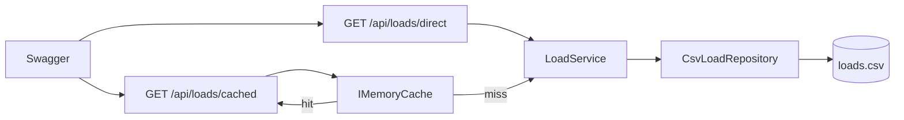

# In-memory cache vs uncached loads

## Purpose

Compare the same `GET` of 10,000 loads from `data/loads.csv` with and without `IMemoryCache`.

- `GET /api/loads/direct` reads and parses the CSV on every request.
- `GET /api/loads/cached` uses cache-aside: miss fills `IMemoryCache`, later hits return the stored list until TTL expires.

The CSV is not cached inside the repository. That keeps the uncached path expensive so the difference shows up in Swagger and in the logs.

## Flow



On a cache miss, `MemoryCachedLoadService` takes a lock so concurrent requests do not all parse the CSV at once. After the fill, they share the same list. Entries expire with `LoadsCache:AbsoluteExpirationSeconds` (default 60).

## Why IMemoryCache here

This is one API process and a large, repeated read. The list stays as objects in the process heap, so a hit skips both the file and JSON-from-Redis. Redis would still deserialize the full payload on every request.

`IMemoryCache` does not share state across instances. Redis would be the next step for multiple API processes or small keys such as last GPS position.

## Configuration

```json
"LoadsData": {
  "FilePath": "data/loads.csv",
  "MaxItems": 10000
},
"LoadsCache": {
  "AbsoluteExpirationSeconds": 60
}
```

`LoadsData:MaxItems` caps how many CSV rows both endpoints return. Cache TTL is bound with `IOptions<LoadsCacheOptions>`.

## How to run

```bash
dotnet run --launch-profile http
```

Open Swagger at http://localhost:5134/swagger.

1. Execute `GET /api/loads/direct` twice. Both calls parse the CSV. Headers: `X-Data-Source: csv`, `X-From-Cache: false`.
2. Execute `GET /api/loads/cached` once (miss). Headers: `X-Data-Source: csv`, `X-From-Cache: false`.
3. Execute `GET /api/loads/cached` again (hit). Headers: `X-Data-Source: memory-cache`, `X-From-Cache: true`. `X-Source-Elapsed-Ms` should drop. After the 60s TTL the next call is a miss.

`/direct` never reads `IMemoryCache`. Postman total time still includes JSON serialization and download of 10,000 rows, so the two URLs can look similar in the client. Compare `X-Source-Elapsed-Ms` and the logs (`Reading loads from CSV` vs `Load cache hit`) instead of the Postman clock alone.

```bash
dotnet test tracking-management-api.slnx
```

## What to look for in the logs

Logs go to `logs/tracking-management-api-YYYYMMDD.txt` (Serilog file sink, not the console). Tail that file while you call the endpoints.

Every 10 seconds:

```
Endpoint stats: name=loads.direct ... p95=3200 heapMB=812.0 ... cacheHits=n/a cacheMisses=n/a
Endpoint stats: name=loads.cached ... p95=40 heapMB=210.0 ... cacheHits=3 cacheMisses=1
```

| Field | Direct | Cached |
| --- | --- | --- |
| Swagger duration / `p95` | Stays high on every Execute | First Execute is slow; the next ones are fast until TTL |
| `cacheHits` / `cacheMisses` | `n/a` | Hits grow on repeats; misses on first fill and after expiration |
| `heapMB` | Grows if you spam Execute | Jumps once when the list is stored, then stays flatter |

A miss log line (`Load cache miss for loads:all`) appears on the first fill and again after expiration.

## What this does not show

Cache does not replace a message broker. Use a queue when work is asynchronous (ingest GPS pings, 202 Accepted). Use cache when many readers ask for the same data in the request path.
