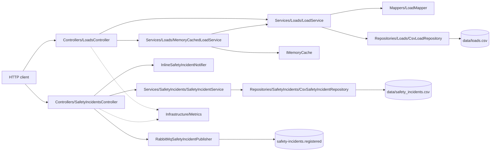

# Project structure

## Purpose

The API uses a repository-service layout. Business code sits in shared folders. Messaging-style support and endpoint metrics stay under `Infrastructure`. Compiler output stays in `artifacts/`.

## Layout

```text
Controllers/
  LoadsController.cs
  SafetyIncidentsController.cs
Models/
  Load.cs
  SafetyIncident.cs
Dtos/
  LoadDto.cs
  LoadReadResult.cs
  CreateSafetyIncidentRequest.cs
  SafetyIncidentDto.cs
  SafetyIncidentRegisteredMessage.cs
Mappers/
  ILoadMapper.cs
  LoadMapper.cs
  ISafetyIncidentMapper.cs
  SafetyIncidentMapper.cs
Validators/
  CreateSafetyIncidentRequestValidator.cs
Options/
  Loads/
    LoadsDataOptions.cs
    LoadsCacheOptions.cs
  SafetyIncidents/
    SafetyIncidentsOptions.cs
Services/
  Loads/
    ILoadService.cs
    LoadService.cs
    ICachedLoadService.cs
    MemoryCachedLoadService.cs
    ILoadCacheStats.cs
  SafetyIncidents/
    ISafetyIncidentService.cs
    SafetyIncidentService.cs
    ISafetyIncidentNotifier.cs
    SafetyIncidentNotifierKeys.cs
    InlineSafetyIncidentNotifier.cs
Repositories/
  Loads/
    ILoadRepository.cs
    CsvLoadRepository.cs
    LoadCsvMap.cs
  SafetyIncidents/
    ISafetyIncidentRepository.cs
    CsvSafetyIncidentRepository.cs
    SafetyIncidentCsvMap.cs
Infrastructure/
  Metrics/
  Messaging/
  Validation/
Extensions/
  ServiceCollectionExtensions.cs
docker-compose.yml  RabbitMQ with management UI
logs/               Serilog .txt files; gitignored
artifacts/          generated by dotnet build; gitignored
```

`artifacts/` replaces the old `bin/` and `obj/` folders. `Directory.Build.props` sets `UseArtifactsOutput` so the API and the test project write there.

## Request flow



The loads controller depends on `ILoadService` for `GET /api/loads/direct` and on `ICachedLoadService` for `GET /api/loads/cached`. The uncached service depends on `ILoadRepository` and `ILoadMapper`. The cached service wraps the uncached service and `IMemoryCache`. Metrics observe the HTTP action and report cache hit/miss counts.

`SafetyIncidentsController` depends on `ISafetyIncidentService` for both `POST /api/safety-incidents/direct` and `POST /api/safety-incidents/queued`. Follow-up work uses keyed `ISafetyIncidentNotifier` implementations: `inline` waits inside the request; `rabbitmq` publishes to the durable queue. A separate console consumer (not in this project) reads that queue.

## Decisions

- `Controllers`, `Services`, and `Repositories` are the repository-service layers. Inside `Services`, `Repositories`, and `Options`, each entity has its own folder (`Loads` and `SafetyIncidents`). `Models`, `Dtos`, and `Mappers` stay in their own folders so the transport model is not mixed with the CSV model.
- Cache is a decorator (`MemoryCachedLoadService`), not a flag inside `LoadService`, so the direct endpoint cannot accidentally read from cache.
- Endpoint metrics live under `Infrastructure`. They support the feature and are not a second business module. RabbitMQ connection and publish code also live under `Infrastructure/Messaging`.
- `Extensions/ServiceCollectionExtensions.cs` remains the composition root that registers loads, safety incidents, RabbitMQ and metrics.

## Assumptions

- One web project is enough. Splitting these folders into separate `.csproj` files would add projects without a second deployable unit.
- `dotnet run` and `dotnet test` still use the same project paths. The debugger profile in `.vscode/launch.json` points at `artifacts/bin/tracking-management-api/debug/`.
