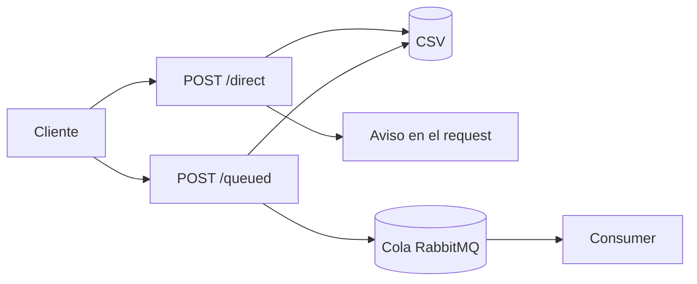

# Comparación: registro de incidentes directo vs RabbitMQ

## Qué se compara

Los dos endpoints guardan el mismo incidente de seguridad en `data/safety_incidents.csv`. La única diferencia es cuándo se hace el trabajo de seguimiento (un aviso simulado de unos 8 segundos, como si el servicio de notificación fuera lento):

- `POST /api/safety-incidents/direct` lo hace **dentro de la petición**. El cliente espera a que termine.
- `POST /api/safety-incidents/queued` **publica un mensaje en RabbitMQ** y responde de inmediato. El consumer de consola hace ese trabajo después.



## Configurar credenciales de RabbitMQ

Usuario y contraseña **no se commitean**. En `appsettings.json` y `appsettings.Development.json` el valor es el placeholder `<Set_In_Secret>`. Si no configuras los secretos, el API no arranca.

En Development se cargan con user secrets. Desde la raíz del repo, una sola vez por máquina:

```bash
dotnet user-secrets set "RabbitMq:UserName" "guest" --project tracking-management-api.csproj
dotnet user-secrets set "RabbitMq:Password" "guest" --project tracking-management-api.csproj
```

Esos valores tienen que coincidir con el broker (`guest` / `guest` en `docker-compose.yml` para la demo local). No se guardan en git: viven en `~/.microsoft/usersecrets/`.

En otro ambiente usa variables de entorno: `RabbitMq__UserName` y `RabbitMq__Password`.

El consumer usa la misma estrategia cuando exista. Ver [safety-incident-consumer-agent-instructions.md](safety-incident-consumer-agent-instructions.md).

## Cómo ejecutarlo

En tres terminales, en este orden (después de configurar los secretos):

```bash
docker compose up -d
dotnet run --launch-profile http
```

El consumer (cuando exista en `consumers/safety-incident-consumer`) se arranca con:

```bash
dotnet run --project consumers/safety-incident-consumer
```

| Recurso | URL |
| --- | --- |
| API / Swagger | http://localhost:5134/swagger |
| RabbitMQ Management | http://localhost:15672 (`guest` / `guest`) |
| Cola | `safety-incidents.registered` |
| Log de la API | `logs/tracking-management-api-YYYYMMDD.txt` |
| Log del consumer | `logs/safety-incident-consumer-YYYYMMDD.txt` |

## Ejecutar ambos endpoints

Cuerpo de ejemplo (el `incidentId` y el `claimAmount` los asigna el API):

```json
{
  "tripId": "TRIP00036079",
  "truckId": "TRK00006",
  "driverId": "DRV00006",
  "incidentDate": "2023-04-09T14:00:00",
  "incidentType": "Moving Violation",
  "locationCity": "Columbus",
  "locationState": "PA",
  "atFaultFlag": true,
  "injuryFlag": false,
  "vehicleDamageCost": 100.5,
  "cargoDamageCost": 50.25,
  "preventableFlag": true,
  "description": "Severe incident involving equipment"
}
```

Directo (espera el aviso; responde `201`):

```bash
curl -i -X POST http://localhost:5134/api/safety-incidents/direct \
  -H "Content-Type: application/json" \
  -d @- <<'JSON'
{
  "tripId": "TRIP00036079",
  "truckId": "TRK00006",
  "driverId": "DRV00006",
  "incidentDate": "2023-04-09T14:00:00",
  "incidentType": "Moving Violation",
  "locationCity": "Columbus",
  "locationState": "PA",
  "atFaultFlag": true,
  "injuryFlag": false,
  "vehicleDamageCost": 100.5,
  "cargoDamageCost": 50.25,
  "preventableFlag": true,
  "description": "Severe incident involving equipment"
}
JSON
```

Con cola (responde `202` en cuanto RabbitMQ acepta el mensaje):

```bash
curl -i -X POST http://localhost:5134/api/safety-incidents/queued \
  -H "Content-Type: application/json" \
  -d @- <<'JSON'
{
  "tripId": "TRIP00036079",
  "truckId": "TRK00006",
  "driverId": "DRV00006",
  "incidentDate": "2023-04-09T14:00:00",
  "incidentType": "Moving Violation",
  "locationCity": "Columbus",
  "locationState": "PA",
  "atFaultFlag": true,
  "injuryFlag": false,
  "vehicleDamageCost": 100.5,
  "cargoDamageCost": 50.25,
  "preventableFlag": true,
  "description": "Severe incident involving equipment"
}
JSON
```

Veinte peticiones en paralelo contra un endpoint (cambiar `direct` por `queued` para el otro):

```bash
for i in $(seq 1 20); do
  curl -s -o /dev/null -w "%{http_code} time=%{time_total}\n" \
    -X POST "http://localhost:5134/api/safety-incidents/direct" \
    -H "Content-Type: application/json" \
    -d '{"tripId":"TRIP00036079","truckId":"TRK00006","driverId":"DRV00006","incidentDate":"2023-04-09T14:00:00","incidentType":"Moving Violation","locationCity":"Columbus","locationState":"PA","atFaultFlag":true,"injuryFlag":false,"vehicleDamageCost":100.5,"cargoDamageCost":50.25,"preventableFlag":true,"description":"Severe incident involving equipment"}' &
done
wait
```

## Comparar resultados

| Qué mirar | `/direct` | `/queued` |
| --- | --- | --- |
| Código HTTP | `201 Created` | `202 Accepted` |
| Header `X-Processing` | `inline` | `queued` |
| Header `X-Elapsed-Ms` | Cerca de 8000 ms (incluye el aviso lento) | Unos pocos ms (solo validar, guardar y publicar) |
| Header `X-Message-Id` | No | Guid del mensaje publicado |
| `p95` en el log de la API (`safety-incidents.direct` vs `safety-incidents.queued`) | Alto y estable | Bajo |
| Cola en http://localhost:15672 | No se usa | Sube si el consumer está apagado; baja cuando lo arrancas |
| Log del consumer | No escribe nada | Una línea `Received` y una `Processed` por cada POST |

El tiempo total en el cliente de `/direct` incluye los ~8 s del aviso. En `/queued` ese trabajo se ve en el log del consumer, no en la respuesta HTTP.

## Escenarios para clase

1. **Cola acumulada.** Deja el consumer apagado y lanza varios POST a `/queued`. En la UI de RabbitMQ, `Ready` de `safety-incidents.registered` sube. El API sigue respondiendo `202`.
2. **La cola se vacía.** Arranca el consumer. `Ready` baja y el log del consumer crece (un `Processed` por mensaje).
3. **Redelivery.** Con el consumer en marcha, mátalo a mitad de un mensaje (antes del `ack`). Al volver a arrancarlo, ese mensaje aparece otra vez y el log muestra `Redelivered`.
